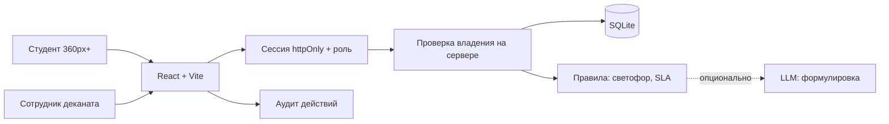

# План: «Цифровой деканат будущего» — MGIMO AI Challenge, номинация «Вайб-кодинг»

Дата плана: 20.11.2026, 21:30 МСК. Дедлайн приёма: **22.11.2026, 23:59 МСК**. Итоги: 28.11.2026.

## 1. Вердикт

Делаем. Ядро — типовой CRUD + авторизация без внешних зависимостей; главный риск не в коде, а в критерии «Масштаб использования нейротехнологий»: он оценивается по документу о процессе, а не по приложению. Поэтому промптбук и журнал итераций ведутся с первой минуты, а не «потом восстановим».

Приз не гарантирован: в вайб-кодинге самая высокая конкуренция из трёх номинаций.

## 2. Границы

В работе:

- прототип на 5 разделов ядра + 3 дифференциатора + кабинет сотрудника;
- мобильный веб от 360 px;
- два студенческих аккаунта с разными данными и один сотрудника;
- документ процесса (PDF) со скриншотами, промптами и ошибками ИИ;
- видео ≤ 5 минут (экран + телефон);
- деплой на выданный VPS с проверкой доступности из РФ.

Не в работе: номинации «ИИ-проект» и «ИИ-ролик», нативные приложения, реальные интеграции с системами вуза, парсинг живого расписания, платежи, чат с сотрудником в реальном времени, PWA/офлайн.

## 3. Критерии → артефакты

| Критерий (10 баллов) | Чем закрываем | Где смотреть |
|---|---|---|
| Проработанность идеи | 5 разделов ядра, 3 дифференциатора с обоснованием, сценарии из болей, полный сквозной путь | `docs/00-concept.md`, сам прототип |
| Масштаб использования ИИ | Промптбук (13 стадий, дословные промпты), журнал удачных/неудачных итераций, перечень инструментов, `AGENTS.md` как контракт для ассистента | `docs/05-promptbook.md`, `docs/06-iterations.md`, `docs/04-tools.md`, `AGENTS.md` |
| Имплементация | Запуск по README с нуля, сквозной путь, сохранение данных между перезапусками, 2+ аккаунта, серверная изоляция, bcrypt, секреты в env, только вымышленные данные | `docs/01-architecture.md`, `docs/02-security.md`, `scripts/verify-*.ts` |
| Качество | Единая дизайн-система, пустые/загрузочные/ошибочные состояния, 360 px, скорость, читаемые результаты | `docs/03-design-system.md`, скриншоты |

Обязательные формальности: дисклеймер «концепт для конкурса, не официальный сервис МГИМО», собственный логотип, лицензированные шрифты и иконки.

## 4. Продукт

### Роли

- **Студент** — видит только свои данные; расписание, оценки, заявки, уведомления.
- **Сотрудник деканата** — очередь заявок с SLA, публикация объявлений, изменение расписания.

### Дифференциаторы (по 1 экрану, без раздувания)

1. **Светофор сессии.** Детерминированные правила по оценкам и долгам → «закроешь 2 долга — сессия без риска», с указанием, что именно менять. ИИ только формулирует объяснение, решение считается правилами.
2. **Заявка как трекер.** Статусы «подана → в работе → готова», обещанный срок, причина отказа, история. Сотрудник двигает статус — студент видит изменение без перезагрузки страницы.
3. **«Что изменилось».** На главной — дифф с прошлого визита: перенос занятия, новая оценка, смена статуса заявки. Закрывает боль «объявления в чатах и на почте».

### Экраны

| Экран | Содержание | Состояния |
|---|---|---|
| Вход | email + пароль, демо-подсказка аккаунтов, ошибка без утечки «пользователь существует» | ошибка, загрузка, rate-limit |
| Главная | приветствие, сегодняшние пары, «что изменилось», светофор, ближайший дедлайн, активные заявки | пусто (нет пар), загрузка |
| Расписание | день/неделя, аудитория, преподаватель, переносы и отмены выделены | пусто, конфликт |
| Успеваемость | дисциплины, оценки, зачёты, сессия, GPA, долги | нет оценок |
| Заявки | список, создание (справка/заявление), статус, срок | пусто, отказ, просрочка |
| Уведомления | объявления деканата, изменения расписания, дедлайны, непрочитанные | пусто |
| Деканат (staff) | очередь заявок, смена статуса, публикация объявления, правка пары | пусто, ошибка |

## 5. Архитектура

- React 19 + Vite (TypeScript) на клиенте, Express 5 на сервере, Tailwind CSS v4, better-sqlite3, zod.
- Сессия — подписанная httpOnly cookie, роль в сервере, не в клиенте.
- Все чтения и записи фильтруются по `session.userId`; идентификатор из URL никогда не принимается как основание доступа.
- ИИ-помощник: правила → рекомендация; LLM вызывается только на сервере, если задан ключ, иначе шаблонный текст. Демо работает без ключа.
- Деплой: `next build` (standalone) + systemd + Caddy (TLS), SQLite-файл вне git.

## 6. Модель данных

| Сущность | Поля (суть) |
|---|---|
| users | id, email, password_hash, role, full_name, faculty, program, course, group, created_at |
| sessions | id, user_id, expires_at, revoked_at |
| teachers | id, full_name, title |
| rooms | id, name, building |
| courses | id, title, teacher_id, credits, control_form (экзамен/зачёт) |
| lessons | id, course_id, room_id, starts_at, ends_at, kind, status (норма/перенос/отмена), note |
| enrollments | id, user_id, course_id, grade, grade_kind, retake_count, status |
| requests | id, user_id, type, template, payload_json, status, due_at, staff_comment, created_at, updated_at |
| request_events | id, request_id, status, comment, actor_id, created_at |
| announcements | id, title, body, audience, published_at, author_id |
| notifications | id, user_id, kind, ref_id, read_at, created_at |
| audit_log | id, actor_id, action, entity, entity_id, meta_json, created_at |

Данные вымышленные: ФИО, группы, оценки. Реальные люди и номера зачёток не используются.

## 7. Безопасность (обязательные проверки)

| Требование | Реализация | Как проверяем |
|---|---|---|
| Студент видит только своё | серверный фильтр по сессии, 404 на чужой id | `scripts/verify-idor.ts`: запрос чужой заявки/профиля → 404 |
| Пароли не в открытом виде | argon2id (или bcrypt cost ≥ 12) | скрипт печатает префикс хеша, не пароль |
| Ключи не в коде и не в браузере | `.env` + `.env.example`, серверный вызов LLM | `rg` по репозиторию и по `.next/static` |
| Нет скрытых настроек | README: `npm ci && npm run seed && npm run dev` | запуск с чистой папки `node_modules` |
| Только открытые/вымышленные данные | сид-файл, дисклеймер в футере | ревью сида |

## 8. Фазы и время

| Фаза | Когда | Часы | Выход |
|---|---|---|---|
| Ф0. План, каркас, промптбук | пт 20.11, вечер | 3 | готово |
| Ф1. Данные, auth, изоляция | пт 20.11 ночь | 3 | готово: 3 аккаунта, сид, 15 проверок доступа |
| Ф2. Ядро UI | пт 20.11 | 4 | готово: расписание, успеваемость, главная |
| Ф3. Заявки, уведомления, staff | пт 20.11 | 4 | готово: сквозной путь заявки, очередь деканата |
| Ф4. ИИ-помощник, состояния | пт 20.11 | 3 | готово: светофор, пусто/загрузка/ошибка, 360 px |
| Ф5. Деплой и проверки | ждёт VPS | 3 | Локально проверено: 360 px, изоляция, production-старт; осталось HTTPS и доступ из РФ |
| Ф6. Документ и видео | пт 20.11 | 5 | PDF готов (9 страниц); видео — по сценарию `docs/11-video-script.md` |
| Ф7. Отправка | вс 22.11 | 1 | Только по команде заказчика: работу отправляет он сам |
| Буфер | вс 22.11, 21:00–23:59 | 2:50 | Правки по факту |

Итого ~26 ч работы при ~50 ч календарных. Команда 1/3, параллелить не с кем. Фактически Ф0–Ф4 и документ закрыты за один вечер, остались деплой (ждёт VPS) и видео.

## 9. Риски

| Риск | Вер. | Влияние | Действие |
|---|---|---|---|
| Документы участника не загружены → форма отправки закрыта | факт | блокер | Скачать бланк, подписать, загрузить согласие и разворот студенческого билета **сегодня** |
| VPS в Финляндии (Hetzner) недоступен/медленный из РФ | средняя | высокое | Проверить с российского IP сразу после деплоя; запасной вариант — российский хостинг (Timeweb/Beget, ~200 ₽/мес) |
| Порт 443 на VPS занят процессом rclone | высокая | среднее | Освободить порт или терминировать TLS на 8443 + прокси; решить на Ф5 |
| Критерий «Масштаб ИИ» недобран | средняя | высокое | Промпты и скриншоты пишутся по ходу, не восстанавливаются в конце |
| Вёрстка ломается на 360 px | средняя | высокое | Проверка каждого экрана на 360/390/768 сразу после вёрстки |
| Утечка чужой заявки по URL | низкая | критическое | Серверная проверка владения + автотест IDOR |
| ИИ-помощник требует платный ключ | низкая | низкое | Детерминированное ядро, LLM опционален, демо без ключа |
| Не хватает времени на видео | средняя | среднее | Видео по желанию; приоритет — PDF и работающий прототип |

## 10. Определение готовности

1. `git clone` → `npm ci` → `.env` из примера → `npm run seed` → `npm run dev` → вход обоими студентами и сотрудником по README, без ручных правок.
2. Сквозной путь: вход → главная → расписание → оценки → заявка → статус → уведомление; данные живы после перезапуска.
3. Чужая заявка по прямому URL недоступна (автотест зелёный).
4. Все экраны без горизонтальной прокрутки на 360 px.
5. Секретов в репозитории и в клиентском бандле нет.
6. PDF-описание со скриншотами собрано; ссылки на репозиторий, прототип, видео и тестовые аккаунты готовы.
7. В профиле загружены согласие и студенческий билет, стоит галочка Регламента.
8. Работа отправлена в кабинете, доступ жюри к репозиторию проверен в режиме инкогнито.
