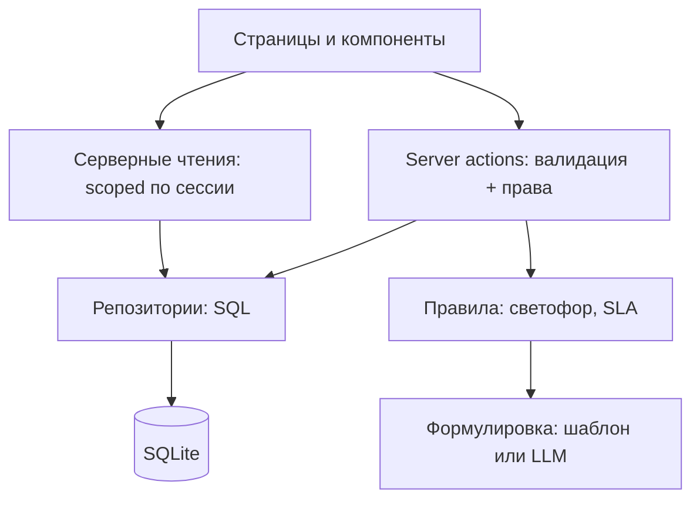
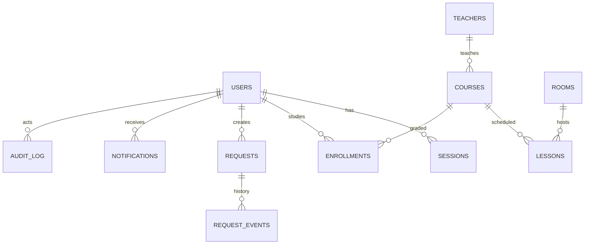
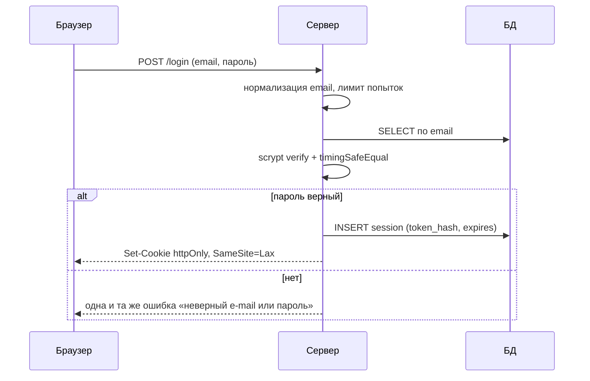
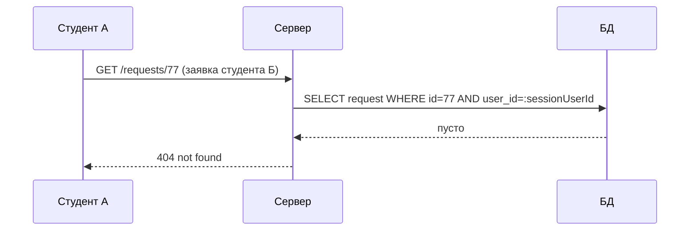

# Архитектура

## 1. Стек и почему

| Слой | Выбор | Почему |
|---|---|---|
| Клиент | React 19 + Vite, TypeScript | быстрая сборка, явные маршруты, никакой серверной магии |
| Сервер | Express 5, TypeScript | один процесс, явные проверки прав на каждом маршруте |
| Стили | Tailwind CSS + CSS-токены | быстрая вёрстка без «дизайна наугад», токены держат единый стиль |
| База | SQLite через `node:sqlite` | встроен в Node 22.5+, нет нативной сборки и компилятора на машине |
| Валидация | zod на границе | одинаковые правила для формы и сервера |
| Пароли | `node:crypto` scrypt | встроено, без нативных сборок, стойко |
| Сессии | подписанная httpOnly cookie + запись в БД | отзыв сессии возможен, токен не читается JS |
| ИИ-помощник | правила + опциональный LLM | демо работает без ключей, результат воспроизводим |
| Деплой | `vite build` + Express раздаёт `dist/` + systemd + Caddy | без Docker, минимум движущихся частей |

Отказ от ORM и от метафреймворка: запросов мало, схема явная, SQL читается человеком и проверяется в `scripts/`. Next.js не взят: его серверные экшены скрывают путь запроса, а для проверки доступа нужен явный HTTP-слой.

## 2. Слои

Правило: ни один компонент не обращается к БД напрямую. Только через репозиторий с обязательным `userId` (кроме staff-выборок, где проверяется роль).

## 3. Маршруты

| Путь | Роль | Что делает |
|---|---|---|
| `/login` | все | вход, демо-подсказка, ошибки |
| `/` | студент | главная: сегодня, изменения, светофор, заявки |
| `/schedule` | студент | день/неделя, переносы, отмены |
| `/grades` | студент | дисциплины, оценки, зачёты, GPA, долги |
| `/requests` | студент | список заявок и статусов |
| `/requests/new` | студент | создание по шаблону |
| `/requests/[id]` | студент | детали, история, причина отказа, загрузка справки (404 на чужую) |
| `/notifications` | студент | объявления и события |
| `/profile` | студент | профиль, выход |
| `/staff` | сотрудник | сводка очереди |
| `/staff/requests` | сотрудник | очередь, фильтры, SLA |
| `/staff/requests/[id]` | сотрудник | смена статуса, комментарий, скачивание вложений |
| `/staff/announcements` | сотрудник | публикация объявления |
| `/staff/schedule` | сотрудник | перенос/отмена пары |
| `/admin` | админ | пары: список, создание, правка, удаление |
| `/admin/teachers` | админ | преподаватели |
| `/admin/rooms` | админ | аудитории |
| `/admin/courses` | админ | дисциплины |
| `/admin/semesters` | админ | семестры |
| `/admin/people` | админ | студенты и сотрудники |
| `/admin/reset` | админ | перезапуск демо-сида |
| `/api/admin/*` | админ | REST: GET/POST/PATCH/DELETE по шести сущностям + `reset-demo` |
| `/api/health` | все | проверка живости для деплоя |

Мутации — server actions. Публичный REST не нужен и не расширяет поверхность атаки.

## 4. Модель данных

| Таблица | Ключевые поля | Индексы |
|---|---|---|
| `users` | `id, email UNIQUE, password_hash, role, full_name, faculty, program, course, group_name, created_at` | email |
| `sessions` | `id, user_id, token_hash, expires_at, revoked_at` | user_id, expires_at |
| `teachers` | `id, full_name, title` | — |
| `rooms` | `id, name, building` | — |
| `courses` | `id, title, teacher_id, credits, control_form` | teacher_id |
| `lessons` | `id, course_id, room_id, starts_at, ends_at, kind, status, note` | course_id, starts_at |
| `enrollments` | `id, user_id, course_id, grade, grade_kind, retake_count, status` | user_id+course_id UNIQUE |
| `requests` | `id, user_id, type, template, payload_json, status, due_at, staff_comment, created_at, updated_at` | user_id, status |
| `request_events` | `id, request_id, status, comment, actor_id, created_at` | request_id |
| `request_attachments` | `id, request_id, user_id, file_name, mime, size, storage_path, created_at` — файл лежит в `data/attachments/<request_id>/` | request_id |
| `announcements` | `id, title, body, audience, published_at, author_id` | published_at |
| `notifications` | `id, user_id, kind, ref_id, title, body, read_at, created_at` | user_id+read_at |
| `audit_log` | `id, actor_id, action, entity, entity_id, meta_json, created_at` | actor_id, entity |

Поля-статусы — только из перечня в коде (TS union), свободные строки не принимаются.

### 4.1 Миграция роли admin

Схема `users` создавалась с `CHECK (role IN ('student','staff'))`. SQLite не меняет CHECK через `ALTER TABLE`, поэтому `widenUsersRoleCheck()` в `server/db.ts` читает `sqlite_master.sql` и, если `admin` в CHECK нет, пересоздаёт таблицу: `PRAGMA foreign_keys=OFF` → копия строк в `users_migrated` → `DROP TABLE users` → `RENAME` → `PRAGMA foreign_keys=ON` → `PRAGMA foreign_key_check`. Идентификаторы сохраняются, поэтому внешние ключи сессий, заявок, зачёток и сообщений остаются валидными. Функция идемпотентна: на новой базе CHECK уже содержит `admin`, и она сразу выходит.

## 5. Ключевые потоки

### 5.1 Вход

### 5.2 Чтение чужой заявки

Запрос по `id` без `user_id` в WHERE считается дефектом безопасности. Проверка — `scripts/verify-idor.ts`.

### 5.3 Светофор

1. Репозиторий отдаёт зачёты и оценки студента.
2. Правила в `lib/session-state.ts` считают: долги, просроченные долги, риск.
3. Шаблон формирует текст; если задан `LLM_API_KEY`, тот же факт-набор уходит в модель для переформулировки.
4. Модель не может изменить статус — она получает готовые значения и возвращает только текст. Ошибка модели не ломает экран.

## 6. Конфигурация

| Переменная | Обязательна | Назначение |
|---|---|---|
| `SESSION_SECRET` | да | HMAC для cookie |
| `DATABASE_PATH` | нет | путь к SQLite, по умолчанию `./data/app.db` |
| `LLM_API_KEY` | нет | формулировка объяснений |
| `LLM_BASE_URL` | нет | OpenAI-совместимый endpoint |
| `LLM_MODEL` | нет | имя модели |
| `APP_ORIGIN` | нет | проверка origin при мутациях |

Секреты читаются только на сервере. В клиентский бандл не попадает ничего: переменных окружения с префиксом `VITE_` в проекте нет вовсе, клиент общается с API по относительным путям.

## 7. Переносимость

- Зависимости фиксируются `package-lock.json`; все — чистый JS, без node-gyp.
- Проверено: чистый клон, `npm install` без Visual Studio и без node-gyp. `npm ci` на Windows сходится, но лок-файл собран под Windows: на Linux используйте `npm install` (см. `docs/10-deploy.md`).
- База создаётся миграциями и сидом, а не «файлом от разработчика».
- Запуск не требует Docker, глобальных пакетов и GUI.
- Деплой описывается в `docs/10-deploy.md` и `README`.
