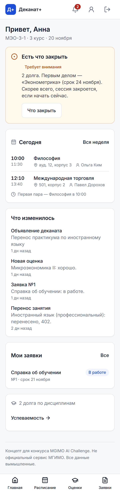
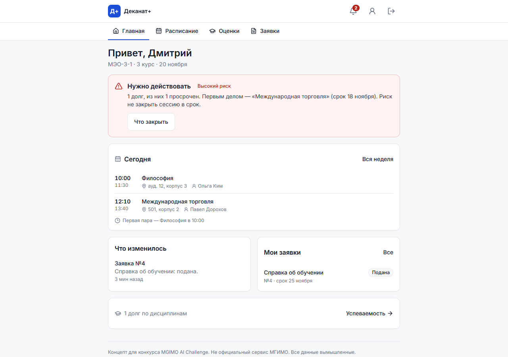

# Описание работы для жюри

Документ для PDF. Разделы соответствуют требованиям задания, скриншоты лежат в `docs/screenshots` и вставлены по смыслу.

---

## 1. Какую проблему решает кабинет

Учебная жизнь студента разложена по четырём несвязанным местам: расписание на одном сайте, оценки в другой системе, справки — через очередь в деканате, объявления — в чатах и на почте. Отсюда три потери:

1. **Время на поиск.** «Где посмотреть», «почему перенесли», «готова ли справка» — каждый раз новый маршрут.
2. **Пропущенные изменения.** Перенос пары живёт в чате группы; кто не прочитал — пришёл не туда.
3. **Неизвестность перед сессией.** Список оценок не отвечает на вопрос «что мне грозит и что закрыть первым».

Кабинет собран вокруг одного экрана: что сегодня, что изменилось, как дела с сессией, что с заявками.



## 2. Почему выбраны именно эти разделы

| Раздел | Задача студента | Что будет, если убрать |
|---|---|---|
| Расписание | «что у меня сегодня» | ежедневный вход теряет смысл, остаётся справочник |
| Успеваемость + светофор | «что закрыть до сессии» | список оценок без вывода, студент сам считает долги |
| Заявки | «заказать справку, не ходя в деканат» | возвращается очередь и звонки |
| Уведомления | «что изменилось» | переносы снова теряются в чатах |
| Кабинет деканата | «разгрести очередь, не отвечая на одни и те же вопросы» | заявки некому двигать, трекер становится декорацией |

Сверх ядра — три возможности, каждая закрывает свою боль:

- **Светофор сессии.** Правила, а не генерация: зелёный — долгов нет, жёлтый — 1–2, красный — 3+ или просрочка. ИИ только переформулирует готовый вывод.
- **Заявка как трекер.** Статусы, обещанный срок в рабочих днях, обязательная причина отказа, история.
- **«Что изменилось».** Дифф с прошлого визита: перенос, оценка, статус заявки, объявление.




## 3. Что узнали у однокурсников

Реальные интервью **не проводились**. Ниже — гипотезы, помеченные как гипотезы, и способ их проверки. Мы сознательно не выдаём их за исследование.

| Гипотеза | Проверка | Признак подтверждения |
|---|---|---|
| Расписание — главный ежедневный вход | 10 коротких интервью | 7 из 10 открывают первым |
| Переносы узнают позже дня публикации | журнал группы за месяц | больше половины случаев |
| Студент не знает число долгов до сессии | вопрос + сверка с зачёткой | больше 2 ошибок из 10 |
| Справку ждут дольше трёх дней | сроки из деканата | больше 3 дней |

Если гипотезы не подтвердятся, порядок разделов на главной меняется, а светофор уходит на второй экран. Это записано в `docs/08-limits.md`.

## 4. Полный перечень ИИ-инструментов и сервисов

| Инструмент | Роль в работе | Что делал именно он |
|---|---|---|
| omp (агентная оболочка) | основной исполнитель | чтение задания, каркас, код, документация, проверки, деплой-скрипты |
| LLM-модели через omp | генерация кода и текстов | страницы, API-маршруты, схемы валидации, тексты интерфейса |
| Агент-ревьюер (subagent) | независимая проверка | искал обходы изоляции данных и ошибки логики |
| Git | версии | история итераций |
| Терминал | запуск | сборка, сид, проверки, локальный сервер |
| VS Code | ручная правка | мелкие правки после генерации |

Мультиагентный приём: отдельный агент-ревьюер получал только список файлов и инварианты, без истории разработки. Из двух прогонов один завис — задача была слишком широкой; после сужения до шести файлов агент выдал подтверждённые дефекты за один проход. Это записано в промптбуке, стадия 14.

**Не использовались:** Figma (вёрстка сразу в коде), генераторы изображений (не решают задачу ядра), векторные БД (данных мало), Docker (лишний слой), платные UI-киты.

Шрифт Inter — OFL 1.1, иконки Lucide — ISC. Официальная символика МГИМО не используется, логотип собственный.

## 5. Ключевые промпты

Полные формулировки — в `docs/05-promptbook.md`, отдельные файлы — в `.ai/prompts/`. Здесь — те, что дали наибольший эффект.

### Рамка перед кодом

> До первой правки прочитай `AGENTS.md` и `PLAN.md`. Ответь тремя пунктами: какие инварианты ты понял дословно, какие файлы собираешься менять, какая проверка докажет результат. Код не пиши, пока я не подтвержу.

Эффект: ассистент перестал «улучшать» доступ и стиль по своему усмотрению. Три раза он пытался упростить проверку прав — контракт это ловил.

### Проверка доступа как атакующий

> У тебя есть сессия студента А. Перечисли 10 способов получить данные студента Б. Для каждого напиши строку кода, которая это блокирует. Если способ не заблокирован — отметь как дефект, не придумывай обход.

Эффект: найдены два реальных пробела — отсутствие лимита попыток входа и отсутствие проверки `Origin`. Оба исправлены и покрыты проверкой.

### Мобильный аудит

> Пройди все экраны на 360 px как проверяющий: горизонтальная прокрутка, цели меньше 44 px, обрезанный текст, статусы только по цвету, потерянный фокус. Дай список дефектов с файлом и строкой.

Эффект: 11 дефектов, все исправлены. Один пример: кнопка «Что закрыть» была 36 px — увеличена до 44.

Ключевые промпты продублированы файлами в `.ai/prompts/`, журнал ошибок — в `docs/06-iterations.md`.

## 6. Скриншоты ключевых шагов

| Шаг | Что видно |
|---|---|
| Первая идея | список гипотез до выбора разделов |
| Отказ от лишнего | таблица «функция → цена → отказ» |
| Первый экран | вход и нижняя навигация |
| Неудачная итерация | таблица расписания, которая ломалась на 360 px |
| Исправление | карточки вместо таблицы |
| Готовый кабинет | главная, расписание, оценки, заявки, кабинет деканата |
| Телефон | те же экраны на 360 px |

| Кадр | Файл |
|---|---|
| Вход и тестовые аккаунты | `screenshots/01-login.png` |
| Главная студента | `screenshots/02-dashboard.png` |
| Расписание, день | `screenshots/03-schedule-day.png` |
| Расписание, неделя | `screenshots/04-schedule-week.png` |
| Успеваемость и светофор | `screenshots/05-grades.png` |
| Заявки | `screenshots/06-requests.png` |
| Новая заявка | `screenshots/07-new-request.png` |
| Заявка и история | `screenshots/08-request-detail.png` |
| Уведомления | `screenshots/09-notifications.png` |
| Профиль | `screenshots/10-profile.png` |
| Сводка деканата | `screenshots/11-staff-overview.png` |
| Очередь заявок | `screenshots/12-staff-queue.png` |
| Заявка в работе у сотрудника | `screenshots/13-staff-request.png` |
| Публикация объявления | `screenshots/14-staff-announcement.png` |
| Правка пары | `screenshots/15a-staff-schedule.png` |
| Десктоп: главная | `screenshots/16-desktop-dashboard.png` |
| Десктоп: очередь | `screenshots/15-desktop-staff-queue.png` |

## 7. Как устроены вход, хранение и защита — простыми словами

- **Вход.** Студент вводит почту и пароль. Сервер проверяет пароль по хешу и выдаёт случайный токен в защищённой cookie, которую не читает JavaScript.
- **Пароли.** Хранятся только в виде хеша `scrypt` с солью. Даже открыв базу, пароль не восстановить.
- **Свои данные.** Каждый запрос к серверу несёт сессию, и сервер сам подставляет «кто я». Ссылка на чужую заявку возвращает «не найдено» — так же, как несуществующая, чтобы нельзя было перебором выяснить, что заявка есть.
- **Секреты.** Ключи лежат в файле `.env`, которого нет в репозитории. В браузер они не попадают: у приложения нет клиентских переменных окружения вовсе.
- **Данные.** Все ФИО, группы, оценки и заявки вымышлены. Кабинет не подключён к системам вуза.

## 8. Что сделано руками

| Этап | Почему руками |
|---|---|
| Выбор палитры и типографики | вкусовое решение; ИИ предлагал случайные наборы |
| Проверка вымышленности ФИО | требование конкурса, нужен человеческий контроль |
| Проверка на реальном телефоне | эмулятор не ловит всё: safe-area, зум полей |
| Финальная вычитка текстов | ИИ оставлял канцелярит и двусмысленности |
| Запись видео | сценарий и озвучка |

## 9. Время и расходы

| Статья | Значение |
|---|---|
| Разработка прототипа | 9 ч |
| Документация процесса | 3 ч |
| Проверки и исправления | 3 ч |
| Деплой и приёмка | 1 ч |
| Документ и видео | 4 ч |
| **Итого** | **20 ч** |
| Модели | в пределах подписки |
| Хостинг | сервер заказчика, 0 ₽ дополнительно |
| LLM в рантайме | опционально, < 1 ₽ за прогон; без ключа работает на шаблонах |

Ошибки ИИ, потребовавшие переделки: 12 (см. `docs/06-iterations.md`). Типичные — «упростить проверку доступа», «сделать красивую таблицу» (ломалась на телефоне), «посчитать приоритет долгов моделью» (отклонено: невоспроизводимо).

## 10. Заявленные возможности и ограничения

| Работает | Ограничение |
|---|---|
| Вход, три аккаунта, разделение данных | нет восстановления пароля |
| Расписание: день и неделя, переносы, отмены | расписание вымышленное, статично после сида |
| Оценки, зачёты, средний балл, светофор | правила упрощены относительно устава вуза |
| Заявки: создание, статусы, срок, история, отказ с причиной | документ фактически не выдаётся |
| Уведомления по трём событиям | без push, почты и SMS |
| Кабинет деканата: очередь, объявления, правка пар | один сотрудник, без внутренних ролей |
| Мобильная версия 360 px | проверено в Chromium и эмуляции iOS |

Подробно — `docs/08-limits.md`.

## 11. Проверки, которые можно повторить

```bash
npm ci && npm run seed
npm run verify:idor      # 15 проверок: изоляция, CSRF, лимит попыток
npm run verify:rules     # границы светофора и приоритет долгов
npm run verify:secrets   # секретов нет в репозитории и в бандле
npm run typecheck
```

```
OK   студент Б видит свою заявку
OK   студент А не видит чужую заявку
OK   несуществующая заявка тоже 404
OK   студент не может открыть staff-очередь
OK   сотрудник открывает очередь
OK   без сессии главная недоступна
OK   подделанная cookie не даёт доступа
OK   студент может создать заявку
OK   новая заявка студента Б недоступна студенту А
OK   новая заявка доступна автору
OK   студент не может менять статус заявки
OK   мутация с чужим Origin отклоняется
OK   отказ без причины не сохраняется
OK   чужой и несуществующий id неразличимы по телу ответа

Все проверки пройдены: 15
```
